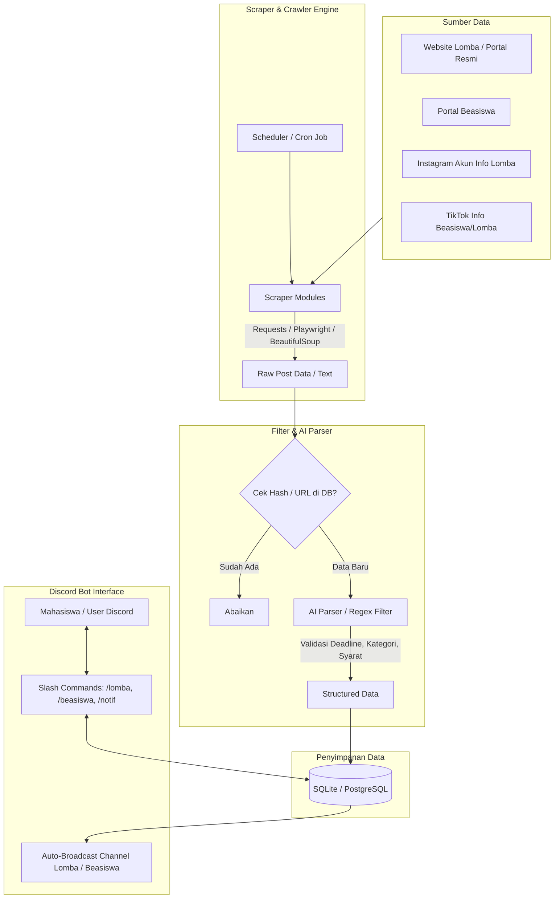

# Rencana Pengembangan Bot Discord Kurator Lomba & Beasiswa Mahasiswa

Dokumen ini merinci rancangan arsitektur, strategi ekstraksi data (web scraping & media sosial), manajemen database, integrasi Discord, serta tahapan eksekusinya.

---

## 1. Goal Description
Membangun bot Discord interaktif yang secara otomatis dan berkala memantau, menyaring (*filter*), serta membagikan informasi **lomba tingkat mahasiswa** dan **beasiswa aktif** ke server Discord. Data dikumpulkan dari:
1. **Situs Web Terverifikasi / Portal Kampus & Pendidikan** (misal: Puspresnas Kemdikbudristek, Dicoding/Kaggle, website kemahasiswaan, portal beasiswa ternama).
2. **Media Sosial** (Instagram & TikTok) menggunakan teknik scraping publik / RSS / headless browser dengan penanganan anti-bot yang aman.
3. **Penyaringan & Normalisasi AI (LLM)**: Menilai relevansi (apakah benar untuk mahasiswa? apakah masih buka?), mengekstrak tanggal deadline, kategori (IT, Bisnis, Desain, Karya Tulis, Beasiswa), dan menyusun ringkasan rapi (*Discord Embed*).

---

## 2. Arsitektur Sistem

---

## 3. Komponen Utama & Teknologi

| Komponen | Pilihan Teknologi | Rationale |
|---|---|---|
| **Bahasa Pemrograman** | Python 3.12+ (atau Node.js TypeScript) | Ekosistem scraping (Playwright, Scrapy, BeautifulSoup) dan integrasi LLM di Python sangat matang. |
| **Discord Library** | `discord.py` / `nextcord` | Lengkap mendukung Slash Commands, Embeds, Modals, Buttons, dan Background Tasks (`tasks.loop`). |
| **Scraping Engine** | `Playwright` / `httpx` + `BeautifulSoup4` | Menangani situs statis dengan cepat via `httpx`, dan halaman dinamis/JS-heavy via `Playwright`. |
| **Social Media Scraping** | Apify API / Playwright Headless / Nitter & RSS bridge | Scraping IG/TikTok langsung rawan IP ban/checkpoint; opsi fallback menggunakan library seperti `instaloader` publik atau integrasi API/RSS bridge. |
| **Database** | `SQLite` (via `Peewee` / `SQLAlchemy`) | Ringan, berbasis file, tanpa konfigurasi rumit untuk tahap awal; mudah dimigrasikan ke PostgreSQL. |
| **Parser & Classifier** | Pydantic + Model AI (Gemini / OpenAI API / Regex) | Mengekstrak tanggal deadline secara akurat dan mengklasifikasikan bidang lomba/beasiswa. |

---

## 4. Fitur & Fitur Interaksi Discord

1. **Auto Broadcast Channel**:
   - `#info-lomba`: Otomatis mengirim embed saat ada lomba baru yang terverifikasi.
   - `#info-beasiswa`: Otomatis mengirim beasiswa yang sedang *open registration*.
2. **Slash Commands**:
   - `/lomba cari [kategori] [keyword]`: Mencari lomba yang masih buka berdasarkan kategori (Coding, Desain, Business Plan, Debat, dll).
   - `/beasiswa cari [tipe]`: Mencari beasiswa (Penuh, Parsial, Dalam Negeri, Luar Negeri).
   - `/deadline [hari]`: Menampilkan daftar lomba/beasiswa yang akan tutup dalam waktu dekat (misal: 3 hari lagi).
   - `/subscribe [kategori]`: Mention role tertentu saat ada info kategori spesifik.
3. **Embed Tampilan Kaya (Rich Embeds)**:
   - Judul & Penyelenggara
   - Tag Kategori & Benefit/Hadiah
   - Tanggal Deadline & Countdown
   - Tautan Resmi Pendaftaran
   - Tombol interaktif: "Simpan ke Bookmark" / "Buka Link Resmi"

---

## 5. User Review & Pertimbangan Kritis

> [!WARNING]
> **Tantangan Scraping Instagram & TikTok**:
> Instagram dan TikTok menerapkan proteksi anti-bot ketat (login wall, rate limit, Cloudflare/CAPTCHA). 
> - Untuk **Instagram/TikTok**, pendekatan terbaik adalah membatasi target pada *profil publik terkurasi* (misal: akun info lomba kampus), mengambil metadata via API publik/RSS bila tersedia, atau menggunakan headless session dengan jeda interval aman.
> - Apakah Anda memiliki daftar akun IG / TikTok atau website resmi tertentu yang ingin diprioritaskan terlebih dahulu?

> [!IMPORTANT]
> **Pemisahan Sumber Website & Sosmed**:
> Website statis/portal resmi jauh lebih stabil dan tahan perubahan struktur HTML dibandingkan media sosial. Kita disarankan memulai fondasi bot dari:
> 1. Modul Bot Discord inti + Database schema.
> 2. Scraper portal lomba/beasiswa berbasis web.
> 3. Scraper media sosial (IG/TikTok) secara bertahap dengan mekanisme error handling khusus.

---

## 6. Tahapan Eksekusi

### Fase 1: Inisialisasi Proyek & Bot Discord Inti
- Inisialisasi struktur proyek (misal: `discord-curator-bot/`).
- Setup `discord.py`, konfigurasi token bot, command handler, dan database SQLite (tabel: `competitions`, `scholarships`, `channels`).

### Fase 2: Scraper Website Portal Lomba & Beasiswa
- Buat modul scraper dasar untuk 2-3 sumber website terverifikasi (contoh: portal lomba mahasiswa nasional, portal beasiswa terpercaya).
- Terapkan pipeline deduplikasi (*content hashing* / URL unique) agar tidak terjadi spam notifikasi berulang.

### Fase 3: Integrasi Social Media Scraper (IG & TikTok)
- Implementasi worker scraper untuk mengekstrak postingan dari akun Instagram publik yang dipilih.
- Ekstraksi teks caption, link pendaftaran (biasanya di bio/linktree), dan deadline.

### Fase 4: Sistem Filter AI & Scheduler Otomatis
- Ekstrak info penting (nama lomba, deadline, penyelenggara, syarat mahasiswa) menggunakan parser regex / LLM prompt.
- Background task setiap $X$ jam untuk mengecek postingan baru dan mem-broadcast ke channel Discord yang ditentukan.

### Fase 5: Pengujian & Dokumentasi
- Uji coba slash commands di Discord.
- Uji coba simulasi penemuan lomba baru dan pengiriman alert.
